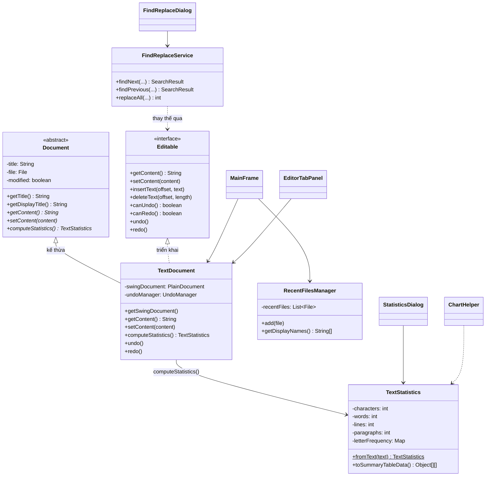
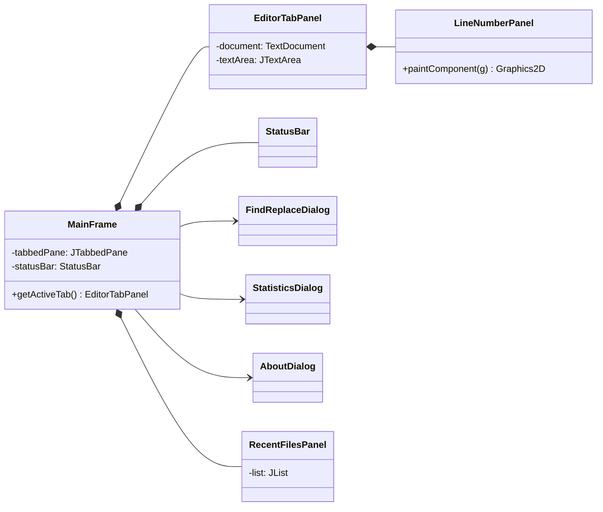

# Sơ đồ lớp UML — Mini Text Editor

## Tổng quan phân cấp

## Tầng giao diện

## Ánh xạ 4 nguyên lý OOP

| Nguyên lý | Hiện thực trong dự án | Vì sao dùng |
|-----------|----------------------|-------------|
| **Trừu tượng** | `Editable`, `Document` (abstract) | Che chi tiết triển khai; UI chỉ phụ thuộc hợp đồng |
| **Đóng gói** | Trường `private` + getter; `TextStatistics` bất biến; `FindReplaceService` | Bảo vệ trạng thái, dễ bảo trì/kiểm thử |
| **Kế thừa** | `TextDocument extends Document` | Tái sử dụng metadata tài liệu (title, file, modified) |
| **Đa hình** | Ghi đè `getContent`, `setContent`, `computeStatistics` | Có thể mở rộng (ví dụ `RichDocument`) mà không sửa UI |

## Luồng nghiệp vụ chính

1. `Main` → `MainFrame.launch()`
2. Mỗi tab = `EditorTabPanel` + `TextDocument`
3. Mở/Lưu qua `FileIOHelper`
4. Tìm–thay qua `FindReplaceDialog` + `FindReplaceService`
5. Thống kê qua `TextStatistics` → `JTable` + `ChartHelper` (JFreeChart)
6. Số dòng vẽ bằng `LineNumberPanel` (Graphics2D)
